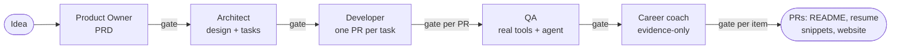

# Agent Studio

A human-gated multi-agent pipeline that takes a project idea through product definition,
architecture, implementation, independent QA and career documentation. Every stage ends at a human
approval gate, every agent action is bounded by code, and every claim in the final career material
has to trace to evidence the system produced.

It is built on the Claude Agent SDK and the Anthropic API, in Python 3.12.

## Why this exists

Agent systems usually fail in three ways: they spend more than expected, they do things nobody
reviewed, and they say things that are not true. Agent Studio is a working answer to each:

| Risk | What stops it |
| --- | --- |
| Runaway spend | Dollar caps per task, per stage and per project; a warning at 80% of the cap that pauses for a decision; a pause switch (`studio pause`, resume any time) |
| Unreviewed actions | A deterministic state machine (no LLM decides what happens next); a human gate after every stage; the agent can never push or open a pull request, only the orchestrator can |
| Made-up claims | QA numbers come from real tools, not a model; pass or fail is computed by a rule; career bullets may only cite evidence built by code, and a number that is not in that evidence is rejected |

## How it works



- **Product Owner and Architect** run on the raw Messages API with a JSON-schema output, validated
  with one retry, and produce a PRD, an architecture, decision records and an ordered task list.
- **Developer** is a Claude Agent SDK agent working in its own git worktree, one task at a time. A
  permission policy allows, asks about or denies every tool call; it runs in a sandbox with secrets
  removed from its environment, under a per-task dollar limit. Its branch is pushed, and the pull
  request opened, by the orchestrator.
- **QA** runs the project's tests, linter, type checker, dependency audit and secret scan as
  plain subprocesses on the merged `main`, then asks a model one question the tools cannot answer:
  does a test actually prove each acceptance criterion? A failed or skipped tool, or a failing
  verdict, fails the report. A criterion with no test is reported as untested.
- **Career coach** turns the finished project into a README, a case study, resume changes, a
  website entry and repository metadata. It may decide a project does not belong on a resume. You
  approve each item separately, and each approved item becomes a pull request you merge.

Each project gets its own private repository (`studio new`), and the whole run is resumable: state
is saved before every question, so a crash or Ctrl-C resumes where it stopped.

## Using it

```
uv sync
uv run studio new my-project                      # private repo on your account, cloned locally
uv run studio run "<idea>" --slug my-project --agent full --repo ~/Desktop/Github/my-project
uv run studio resume my-project --agent full      # after a crash
uv run studio pause my-project                    # stop spending; `studio resume` continues it
```

Secrets go in `.env` (git-ignored): `ANTHROPIC_API_KEY` and a fine-grained `GITHUB_TOKEN`
(Contents and Pull requests, read and write). The career stage also needs a private profile
folder (`AGENT_STUDIO_PROFILE`). `CLAUDE.md` has the full setup, the conventions this repository
follows, and how to run the live tests and evals.

`--agent echo` is a free dummy agent for trying the flow without spending anything.

Prefer a browser to the terminal? Build the React app once (`npm --prefix frontend ci && npm
--prefix frontend run build`), then `uv run --env-file .env studio ui` opens a local control panel:
start projects, see where each one is and what it has cost, and answer every approval in one
inbox. Each resume bullet in the career gate is shown next to the evidence behind it. It listens on
your machine only.

## How it is verified

- **Tests:** over a thousand unit and integration tests, many against real git repositories
  (worktrees, bare remotes) with fake GitHub calls. Changes to safety-critical code were checked
  by mutation: break the code on purpose and confirm a test fails.
- **Live tests** call the real APIs and are opt-in, never run in CI.
- **Evals** (`uv run --env-file .env python -m evals.run --agent qa|career_coach`) score the QA
  agent on 12 tiny projects with known-right verdicts and the career coach on five invented
  projects, with no judge model. Each run is recorded in `evals/results.csv`. The current prompts
  score 100% on both sets, which says these sets are easy: a deliberately lazy QA prompt scored
  79%, so the harness can fail, but it cannot yet rank two good prompts. Harder cases should come
  from real runs.
- **CI** runs ruff, strict mypy and the tests on every pull request; `main` is protected.

## Honest limits

- No complete real project has been run through all five stages yet; the pieces are tested
  individually and in combination, and the live tests have exercised the Developer, QA and coach.
- QA's tool set targets Python projects.
- The resume snippets are LaTeX written in one specific template's macros and have not been
  compiled in Overleaf by this system.
- Private repositories on GitHub's free plan have no branch protection, so the orchestrator only
  pushes `agent/` branches and never forces.

## Layout

```
orchestrator/   state machine, gates, budgets, permissions, worktrees, publishing, CLI
schemas/        Pydantic models for every artifact an agent hands over
agents/prompts/ versioned prompts, the version recorded in every trace event
evals/          datasets, scoring and results.csv
tests/          unit, integration and (opt-in) live tests
docs/plans/     the design notes for each phase
```

The original design is in `Agent Studio Build Plan for Claude Code.md`.
